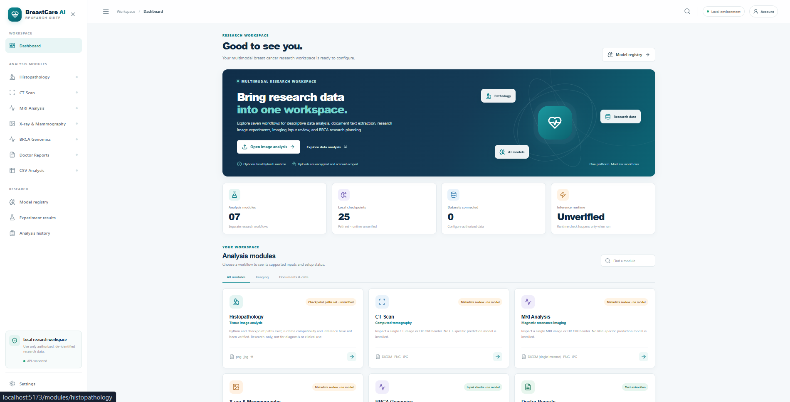

# BreastCare AI

BreastCare AI is a local-first research application for exploring breast-cancer research data workflows. It provides a web dashboard, account registration and sign-in, a catalogue of seven research modules, and limited file preflight tools for selected inputs.

## Project overview

BreastCare AI is a student research project that provides one local workspace for several breast-cancer data tasks. A researcher can open the dashboard, browse the available modules, choose a workflow, and submit an eligible file after signing in. The backend checks the request and returns a result or a clear message explaining why the current project cannot process it.

The project catalogue covers seven areas: CSV analysis, doctor report text extraction, histopathology, CT, MRI, X-ray and mammography, and BRCA cohort data checks. The modules do not all have the same level of implementation. In this repository, CT and MRI support limited DICOM-header inspection, and BRCA supports an in-memory preflight of a de-identified cohort CSV. The remaining module pages describe planned workflows, but their full processing pipelines or prediction models are not included here. Analysis History is not an eighth processing module.

The main goal is to provide a clear foundation for research data handling, with separate workflows for different input types and visible information about each workflow’s status. The application does not claim to diagnose breast cancer or estimate an individual’s genetic risk. It is intended for local research and learning, not clinical use.

> **Research prototype only.** This project is not a clinically validated medical device. It does not provide diagnosis, treatment advice, or individual genetic-risk predictions. Do not use it to make decisions about patient care.

## Project status

The current repository is an early software foundation. The dashboard and module pages are present, but not every module has a working analysis pipeline. The available functions are deliberately described below so that the interface is not mistaken for a set of trained prediction models.

| Module | Current capability |
|---|---|
| Histopathology | Interface is present. A compatible research model and processing pipeline are not included in this repository. |
| CT | Authenticated, in-memory inspection of one DICOM header. It does not read image pixels or predict cancer. |
| MRI | Authenticated, in-memory inspection of one DICOM header. It does not inspect MRI sequences or image pixels. |
| X-ray and mammography | Interface is present. No radiology prediction model is included. |
| BRCA genomics | Authenticated, in-memory preflight of a de-identified cohort CSV. It returns aggregate structure and label checks; it does not interpret variants or predict mutation status. |
| Doctor reports | Interface is present. Text extraction/OCR processing is not implemented in this repository. |
| CSV analysis | Interface is present. The planned general analysis pipeline is not implemented in this repository. |

The module catalogue describes intended workflows and their readiness. A module card or planned feature does not mean that a model is installed or that analysis is available.

## Features

- React, TypeScript, and Vite web interface.
- FastAPI backend with a health endpoint and module catalogue.
- Account registration and sign-in with password hashing and bearer-token authentication.
- SQLite database by default; it is created on first backend startup.
- CT and MRI DICOM header inspection, with a 20 MB per-file limit.
- BRCA cohort CSV preflight, with a 10 MB limit and in-memory processing.
- Docker Compose configuration.
- Windows PowerShell, Windows batch, and Linux/macOS launch scripts.
- Local development after dependencies have been installed.

## Technology

- **Frontend:** React, TypeScript, Vite, React Router
- **Backend:** Python, FastAPI, SQLAlchemy
- **Database:** SQLite by default
- **Medical image header support:** `pydicom`
- **Container option:** Docker Compose

## Requirements

- Python 3.11 or 3.12
- Node.js 20 LTS or newer, including npm
- Optional: Docker Desktop or Docker Engine with Compose
- Optional: Git

The CT/MRI header check requires the backend dependencies, including `pydicom`. No GPU is needed for the current implemented functions. This repository does not include trained medical model weights or patient datasets.

## Run on Windows

1. Download or clone this repository into a writable folder.
2. Open PowerShell in the project folder.
3. Start the local application:

   ```powershell
   .\run_windows.ps1
   ```

   If PowerShell does not allow the script to run, use Command Prompt:

   ```bat
   run_windows.bat
   ```

4. Open the frontend at [http://localhost:5173](http://localhost:5173).
5. Open the backend API documentation at [http://127.0.0.1:8000/docs](http://127.0.0.1:8000/docs).

The launcher creates a backend virtual environment and installs the backend and frontend dependencies when needed. It starts the backend and frontend in separate terminal windows. If either port is already in use, close the existing process before starting another copy.

## Run on macOS or Linux

From the project folder, run:

```bash
chmod +x run_unix.sh
./run_unix.sh
```

Then open [http://localhost:5173](http://localhost:5173) in a browser. The backend API documentation is available at [http://127.0.0.1:8000/docs](http://127.0.0.1:8000/docs).

## Run with Docker Compose

From the project folder, run:

```bash
docker compose up --build
```

Open [http://localhost:5173](http://localhost:5173). The backend API is available on port `8000`. Docker Compose stores the SQLite database in a named volume. Before using this configuration beyond local development, replace the example application secret with a strong private value and review the network exposure settings.

## Manual development setup

### Backend

From the project folder:

```powershell
cd backend
python -m venv .venv
```

Activate the environment in PowerShell and install dependencies:

```powershell
.\.venv\Scripts\Activate.ps1
python -m pip install -r requirements.txt
uvicorn app.main:app --reload --host 127.0.0.1 --port 8000
```

On macOS or Linux, activate it with `source .venv/bin/activate` instead. The backend listens locally on port `8000`.

### Frontend

In another terminal, from the project folder:

```bash
cd frontend
npm install
npm run dev
```

The Vite development server uses port `5173` by default.

## Implemented API endpoints

| Method | Endpoint | Purpose | Access |
|---|---|---|---|
| `GET` | `/api/health` | Reports backend status and database configuration. | Public |
| `GET` | `/api/modules` | Returns the module catalogue and readiness information. | Public |
| `POST` | `/api/auth/register` | Creates a user account. | Public |
| `POST` | `/api/auth/login` | Signs in with a username or email and password. | Public |
| `GET` | `/api/auth/me` | Returns the current account. | Bearer token required |
| `POST` | `/api/research/{ct\|mri}/inspect` | Checks one DICOM header in memory; limited to 20 MB. | Bearer token required |
| `POST` | `/api/research/brca/preflight` | Checks a de-identified cohort CSV in memory; limited to 10 MB. | Bearer token required |
| `POST` | `/api/analysis` | Reports that a compatible analysis pipeline/model is unavailable. | Bearer token required |

The CT/MRI endpoint accepts one `.dcm` or `.dicom` file. It checks header information and excludes pixel data and identifying tags from its response. The BRCA CSV preflight requires the columns `sample_id`, `target_type`, and `label`; it returns aggregate checks and does not save raw rows.

## Configuration

Backend settings can be customized with environment variables or a `backend/.env` file. An example is provided at `backend/.env.example`.

Important settings include:

- `APP_SECRET_KEY` — signing secret for access tokens. Use a long, random private value for any shared environment; do not commit it.
- `DATABASE_URL` — database connection string. SQLite is used by default.
- `TOKEN_TTL_HOURS` — access-token lifetime.
- `FRONTEND_ORIGIN` — allowed frontend origin for local development.

Never expose the development server directly to the public internet. The default configuration is intended for local development only.

## Data and model files

No clinical datasets are bundled. Only use data you are authorized to access and process. De-identify research data before upload and do not include direct patient identifiers.

No trained CT, MRI, mammography, or BRCA prediction models are included. Histopathology inference is not available unless a compatible model and processing pipeline are separately configured. Do not commit private datasets, credentials, local environment files, or large/restricted model weights to Git. See [`datasets/README.md`](datasets/README.md) and [`model_artifacts/README.md`](model_artifacts/README.md) for the project’s data and model guidance.

## Repository structure

```text
backend/          FastAPI application and Python dependencies
frontend/         React + TypeScript application
datasets/         Dataset guidance; no patient dataset is bundled
model_artifacts/  Model guidance; no trained weights are bundled
docker-compose.yml
run_windows.ps1
run_windows.bat
run_unix.sh
```

## Safety and responsible use

- Use only de-identified data for which you have permission to process.
- CT and MRI checks inspect DICOM header information only; they do not interpret scans.
- BRCA preflight checks a cohort table; it does not interpret variants or assess an individual’s risk.
- The report and general CSV processing pipelines are not implemented in this repository snapshot.
- Do not use outputs for diagnosis, treatment, screening, or other clinical decisions.
- Review extracted or summarized information against its original source before relying on it for research.

## Output of the current project.



## Development status and next steps

The current work is a software foundation with limited CT/MRI and BRCA input preflight. Future research development would require authorized datasets, clearly defined research questions and labels, patient-level data separation, suitable model development, independent evaluation, and expert review. A trained model should not be described as clinically validated without appropriate evidence.

See [`RESEARCH_TRACK_STATUS.md`](RESEARCH_TRACK_STATUS.md) for the current CT, MRI, and BRCA track status.

## License and dataset rights

No project license is declared in this repository. Dataset and model permissions may differ from the permissions for the application code. Check the terms of each dataset, model, or dependency before using or redistributing it.
